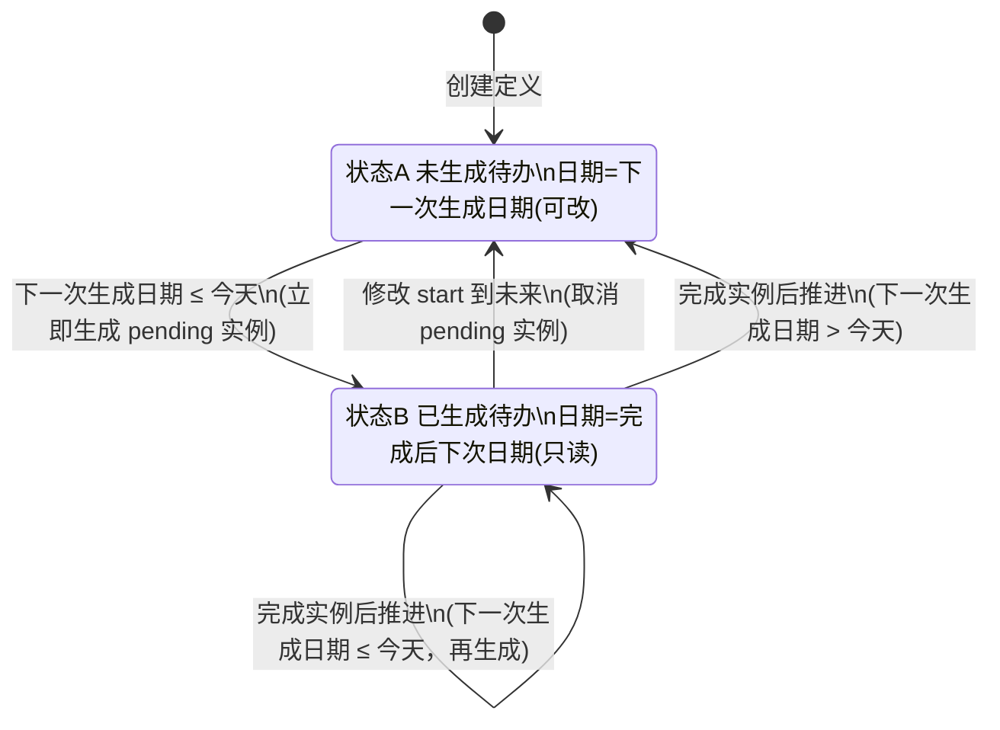

# 循环待办（RecurringTask）逻辑梳理

> 本文档梳理「循环待办」的日期语义、状态机与即时生效规则，作为前后端实现的对齐依据。
> 涉及后端：`project/apps/reconciliation/`（models / serializers / services / views / tasks）；涉及前端：`Beancount-Trans-Frontend/src/views/reconciliation/ReconciliationList.vue`。

---

## 1. 概念与数据模型

| 概念 | 模型 / 字段 | 说明 |
| --- | --- | --- |
| 循环待办定义 | `RecurringTask` | 用户级定义，含 `rule_text`（DSL 原文）、`rrule`（归一化 RRULE）、`recurrence_basis`、`start_date`、`status(active/ended)` |
| 循环待办实例 | `ScheduledTask(task_type='recurring')` | 一次具体待办，含 `scheduled_date`、`completed_date`、`status(pending/completed/cancelled/...)` |
| 循环基准 | `recurrence_basis` | `scheduled`＝按计划日期；`completed`＝`when done`，按完成日期 |
| 规则原文 | `rule_text` | 受控英文 DSL，例如 `every month`、`every month when done` |
| 基准日期 | `start_date` | 定义起算锚点；**未生成待办时可修改** |

**判定「已在循环待办中展示」**：定义下存在 `status='pending'` 的实例（即 `has_pending == true`）。它在「循环」待办页表现为一条待办条目（Obsidian Tasks 风格行式清单：方形复选框 + 标题 + 本次待办日期（可点击改期=顺延）+「下次」生成日期（只读，本次完成后推算，行内以图标标识）；点击复选框即完成、无二次确认；到期筛选 `scheduled_date <= today`）。

---

## 2. 日期字段的两个含义（需求第 0 条）

管理页每行只有一个「日期」单元格，但它随状态在**两种语义**间切换：

| 状态 | 语义 | 可修改 | 取值来源 |
| --- | --- | --- | --- |
| 未生成待办（无 pending 实例） | **本期待办日期** | ✅ 可改（改的就是 `start_date`） | `start_date` 本身（**不再向上取整到规则日**） |
| 已生成待办（有 pending 实例） | **本次待办完成后的下一次待办生成日期** | ❌ 只读 | 由规则推算，完成实例后按规则推进 |

> 语义要点：`start_date` 就是「本期待办日期」。到期（`start_date <= today`）即按该日期生成本期待办；未到期则管理页展示该日期。
> 例：`every month on the 25th`，基准日期 `2026-10-13`（≤ 今天）→ 立即生成日期为 `2026-10-13` 的待办，管理页展示「完成后下次」`2026-10-25`；基准日期 `2026-10-26`（> 今天）→ 不生成，管理页展示 `2026-10-26`。
> 规则日（如 25 日）只影响**后续**日期的推算，不再对基准日期做取整。

因此**可编辑性判定只依赖 `has_pending`**，与 `recurrence_basis` 无关：

```
可修改(date) ⇔ 定义下不存在 status='pending' 的实例
```

> 现状差异：前端 `dateEditable()` 当前为 `!has_pending && basis==='scheduled'`，导致 `when done` 规则在未生成时也无法修改 `start_date`，与需求 2.2 / 3.1 冲突，需放宽为 `!has_pending`。

---

## 3. 状态机



进入 **B** 的条件：`下一次生成日期 <= 今天` 且不存在 pending 实例。
在 **B** 中完成实例后：按规则推进「下一次生成日期」，若仍 `<= 今天` 则继续留在 B（再次生成），否则回到 A。

---

## 4. 日期计算规则

设 `spec = parse(rule_text)`，`today = 当前日期`。

### 4.1 各实例相互独立

生成出来的待办实例之间**没有任何关联**，日期推算只依据三样东西：**定义的预期日期
（`start_date`）**、**当前待执行实例的预期日期（`scheduled_date`）**、以及 **DSL（`rule_text`）**。

- **不再**参考任何 `completed` / `cancelled` 的历史实例（它们不再作为锚点）。
- `pending` = 该定义下 `status='pending'` 的实例（同一时刻至多一个）；无则 `None`。

> 这保证「完成昨天的通知后，仍可把日期调早」：历史完成实例不会把日期锚死。

### 4.2 下一次生成日期 `next_generation_date`

```
若 pending 为空:
    return start_date                                 # 本期待办日期（到期即生成，不取整到规则日）
                                                      # 规则不可满足（无任何发生日）时返回 None
若 basis == 'scheduled':
    return next_occurrence(spec, start_date, pending.scheduled_date)   # 严格晚于本次待办日期
若 basis == 'completed':                              # when done
    anchor = pending.completed_date or pending.scheduled_date
    return next_occurrence(spec, anchor, anchor)      # 以待办日期重新起算
```

### 4.3 管理页展示日期 `display_next_date`

```
pending = 该定义下 status='pending' 的实例
若 pending 为空:                    # 状态 A
    return next_generation_date    # = start_date（本期待办日期）
若 basis == 'scheduled':            # 状态 B
    return next_occurrence(spec, start_date, pending.scheduled_date)
若 basis == 'completed':            # 状态 B（when done）
    return next_occurrence(spec, today, today)         # 假定今天完成 → 今天 + rrule
```

> `when done` 在状态 B 用「今天」为锚点：因为待办完成日期未知，展示「若今天完成则下次为今天+rrule」。

### 4.4 即时生效（需求确认：修改 start_date 立即生效）

修改 `start_date` 等价于**以新日期重新起算**，需在保存后立即执行一次「对齐」：

```
1. 取消该定义下所有 status='pending' 的实例（置 cancelled，不删除，保留历史）
2. cand = 新 start_date                               # 本期待办日期即基准日期
3. 若 cand <= today:
       立即生成 pending 实例(scheduled_date = cand)   → 进入状态 B
   否则:
       不生成                                          → 停留在状态 A
```

> 由于第 1 步取消了 pending，`next_generation_date` 只由新 `start_date` 推出，不被任何历史实例干扰（含已完成实例）。

> 创建定义时同样需要执行上述「对齐」（默认 `start_date = today`，通常会立即生成 → 进入状态 B）。

---

## 5. 场景逐条推演（需求 0–3.2）

基准：`today = 2026-10-12`。

| # | 规则 | 操作 | 结果状态 | 管理页日期（语义 / 可改性） | 循环待办页 |
| --- | --- | --- | --- | --- | --- |
| 1 | 任意（示例 `every month`） | 用默认日期（today）新建 | 立即生成 B | `2026-11-12`＝完成后下次（只读） | 展示该待办 |
| 2.1 | `every month` | start `2026-10-15` → `2026-10-01` | 立即生成 B | `2026-11-01`＝完成后下次（只读） | 展示该待办 |
| 2.2 | `every month when done` | start `2026-10-15` → `2026-10-01` | 立即生成 B | `2026-11-12`＝完成后下次（只读） | 展示该待办 |
| 2.3 | 任意（原 `2026-10-12`） | start `2026-10-12` → `2026-10-13` | 取消 pending → A | `2026-10-13`＝开始日期/下次生成（可改） | 不再展示 |
| 3.1 | `every month when done` | start `2026-10-13` → `2026-10-01` | 立即生成 B | `2026-11-12`＝完成后下次（只读） | 展示该待办 |
| 3.2 | `every month` | start `2026-10-13` → `2026-10-01` | 立即生成 B | `2026-11-01`＝完成后下次（只读） | 展示该待办 |

关键推导：

- **2.1**：`start_date=2026-10-01 ≤ today` → 生成实例（scheduled_date=2026-10-01，即基准日期）；`scheduled` 基准下 `next_occurrence(dtstart=2026-10-01, after=2026-10-01) = 2026-11-01`。
- **2.2**：同上生成实例；`completed` 基准下 `next_occurrence(dtstart=today=2026-10-12, after=today) = 2026-11-12`。
- **2.3**：原 `start=2026-10-12` 已生成 pending；改到未来 `2026-10-13` 后取消 pending，`start_date=2026-10-13 > today` → 停留 A，日期即可修改的本期待办日期。
- **3.1 / 3.2**：由未来日期改到过去，触发即时生成，分别按 `completed` / `scheduled` 基准得到 `2026-11-12` / `2026-11-01`。

### 5.1 从「循环」待办条目顺延（补充边界）

用户在「循环」待办列表的条目上把执行日期从 **2026-10-12 改到未来 2026-10-13**（此时该定义已有 pending 实例）：

| 步骤 | 结果 |
| --- | --- |
| 条目改期前 | 定义存在 pending（`scheduled_date=2026-10-12`），管理行日期按 2.1 只读展示「完成后下一次日期」 |
| 提交条目新日期 | 视为**顺延定义**：`start_date` 置为 `2026-10-13`，取消旧 pending（`cancelled`） |
| 条目改期后 | 该待办不再在「循环」列表展示；管理行日期展示 **2026-10-13**，且为**可修改**的「下一次待办生成日期」（`has_pending=false`，`next_run_date=2026-10-13`） |

即：**只要能改到未来，管理行就必须回到可修改态并展示新日期，而不是继续只读展示「本次待办完成后的下一次待办生成日期」。**

> 与 2.1 一致：管理行**自身**在存在 pending 时仍为只读；「顺延」这一动作由待办条目发起。

---

## 6. 边界与需明确的场景

| 场景 | 建议行为 |
| --- | --- |
| 修改 `start_date` 时已有**已完成**的历史实例 | 历史保留但**不参与任何推算**；`start_date` 即「下一次预期日期」的权威值（`scheduled` 基准下同时作为 `dtstart`）。因此可自由调早/调后并立即生效。 |
| 修改 `start_date` 时规则变更（`rule_text`）同时提交 | 以新规则 + 新 `start_date` 重新对齐，先按新规则解析 `spec` 再执行对齐。 |
| 规则不可满足（如 `every February on the 30th`） | `first_on_or_after` 返回 `None` → 定义置 `ended`，无日期展示。 |
| 定义为 `ended` | 不再生成；管理页可展示但日期只读/为空。 |
| 同一时刻仅一个 pending | 对齐逻辑与 `generate_due` 一致：已有 pending 时不重复生成。 |
| 完成实例使定义 `ended` | 完成后推不出的下一次（`next_occurrence` 为 `None`）→ 置 `ended`。 |
| 完成实例 | 把 `start_date` 推进到下一周期（`scheduled`＝本次预期日期之后；`completed`＝完成日期之后），旧实例随即成为历史、不再影响推算。 |
| 从待办条目把执行日期改到未来 | 顺延定义：`start_date` 置为新日期、取消旧 pending；管理行回到可修改态并展示新日期（见 5.1）。 |
| 从待办条目把执行日期改到过去/今天 | 同样顺延定义并按新日期对齐；若到期则立即生成新实例。 |

---

## 7. 实现落点

### 后端 `project/apps/reconciliation/`

| 文件 | 位置 | 期望 |
| --- | --- | --- |
| `services/recurring_task_service.py` | [`next_generation_date`](file:///home/daihaorui/桌面/GitHub/Beancount-Trans/Beancount-Trans-Backend/project/apps/reconciliation/services/recurring_task_service.py) | 只依据 `start_date` + `pending`（无则 `start_date` 本身，即本期待办日期）；不参考已完成/已取消实例 |
| 同上 | [`complete_instance`](file:///home/daihaorui/桌面/GitHub/Beancount-Trans/Beancount-Trans-Backend/project/apps/reconciliation/services/recurring_task_service.py) | 完成后把 `start_date` 推进到下一周期；到期即生成下一期；各实例互不关联 |
| 同上 | [`display_next_date`](file:///home/daihaorui/桌面/GitHub/Beancount-Trans/Beancount-Trans-Backend/project/apps/reconciliation/services/recurring_task_service.py) | 无 pending＝生成日期；有 pending＝完成后下次 |
| 同上 | [`create`](file:///home/daihaorui/桌面/GitHub/Beancount-Trans/Beancount-Trans-Backend/project/apps/reconciliation/services/recurring_task_service.py) | 创建后立即「对齐」（默认 start＝today 时通常立即生成） |
| 同上 | [`update`](file:///home/daihaorui/桌面/GitHub/Beancount-Trans/Beancount-Trans-Backend/project/apps/reconciliation/services/recurring_task_service.py) | **仅当 `start_date` 变化**时立即「对齐」：取消 pending + 按新 start 生成（若已到期）；仅改 note/template/rule_text 不影响已有实例 |
| 同上 | `_align_schedule` | 封装第 4.4 节逻辑，供 create/update 复用 |
| 同上 | `reschedule` | 顺延：`start_date` 置为新日期 + 对齐（供待办条目改期调用，见 5.1） |
| `views.py` | [`ScheduledTaskViewSet.perform_update`](file:///home/daihaorui/桌面/GitHub/Beancount-Trans/Beancount-Trans-Backend/project/apps/reconciliation/views.py) | 循环待办条目改期 → `RecurringTaskService.reschedule` 顺延其定义 |
| `serializers.py` | [`get_has_pending` / `get_next_run_date`](file:///home/daihaorui/桌面/GitHub/Beancount-Trans/Beancount-Trans-Backend/project/apps/reconciliation/serializers.py#L139-L148) | 定义序列化器：保持字段语义（前端据此判定可改性） |
| `serializers.py` | `ScheduledTaskListSerializer.get_next_run_date` | 实例序列化器新增只读 `next_run_date`＝`RecurringTaskService.display_next_date(defn)`（本次完成后下一次生成日期），供「循环」待办行展示 |
| `tasks.py` | [`generate_due_recurring_tasks`](file:///home/daihaorui/桌面/GitHub/Beancount-Trans/Beancount-Trans-Backend/project/apps/reconciliation/tasks.py#L7-L10) | 兜底定时扫描；即时生效不依赖它 |

### 前端 `ReconciliationList.vue`

| 位置 | 期望 |
| --- | --- |
| [`dateEditable`](file:///home/daihaorui/桌面/GitHub/Beancount-Trans/Beancount-Trans-Frontend/src/views/reconciliation/ReconciliationList.vue#L640-L642) | `!defn.has_pending`（去掉 `basis==='scheduled'` 限制） |
| [`handleStartDateChange`](file:///home/daihaorui/桌面/GitHub/Beancount-Trans/Beancount-Trans-Frontend/src/views/reconciliation/ReconciliationList.vue#L696-L707) | PATCH `start_date` 后 `loadDefinitions()`，刷新即时状态（后端已即时生效） |
| 模板日期单元 | 状态 A 用 `el-date-picker`（可改）；状态 B 展示只读文本，title 提示「本次待办完成后的下一次待办生成日期」 |

---

## 8. 测试用例建议

- `create` 默认日期（today）→ 立即生成 pending，`has_pending=true`，`next_run_date=today+rrule`。
- `every month`：start `2026-10-15 → 2026-10-01` → 生成实例，`next_run_date=2026-11-01`。
- `every month when done`：start `2026-10-15 → 2026-10-01` → 生成实例，`next_run_date=2026-11-12`。
- 已生成后 start 改到未来 → pending 被取消，`has_pending=false`，`next_run_date=新 start_date`。
- `every month when done`：start `2026-10-13 → 2026-10-01` → 生成实例，`next_run_date=2026-11-12`。
- `every month`：start `2026-10-13 → 2026-10-01` → 生成实例，`next_run_date=2026-11-01`。
- `when done` 未生成（无 pending）时管理页日期**可编辑**。
- 取消的历史实例不参与推算（已完成实例同样不参与）。

---

## 9. 一句话总结

管理页「日期」单元是一个**双语义开关**：**无待执行实例**时表示可修改的「本期待办日期（=start_date）」；**有待执行实例**时表示只读的「本次完成后的下一次待办生成日期」。修改 `start_date` 会**立即重算**：到期（`start_date <= today`）即按该日期生成实例（进入只读态），改为未来即取消实例（回到可改态）。

各待办实例之间**没有任何关联**：无论调早还是调后，日期都只由「定义预期日期 `start_date` + 当前 pending 的预期日期 + DSL」决定，已完成/已取消的历史实例一律不参与推算（因此完成昨天的通知后仍可把日期调早）。

---

## 10. 到期产出：生成审核待办（固定模板）

循环待办定义新增「到期产出」`kind`：

| kind | 到期行为 |
| --- | --- |
| `notify`（默认） | 生成一条循环待办条目（现有行为） |
| `generate_review` | 把 `template`（**固定文本，无占位符/表达式**）**原样**并入用户统一审核队列生成审核条目；不生成循环条目 |

### 生成与推进
- 到期（`generate_due` / `_align_schedule`）统一由 `RecurringTaskService._generate_instance` 按 `kind` 分派：
  - `notify` → 创建 `ScheduledTask(status='pending')` 条目；
  - `generate_review` → 调 `RecurringBookkeepingService.generate_for_definition(...)` 入队，并创建一个 `status='completed'` 的 `ScheduledTask` 作为历史记录；由于没有 pending 可等待完成，生成时即把 `start_date` 推进到下一周期。
- **生成即推进**：不等用户确认，本次循环立即推进到下一周期。
- **对齐补齐（日期永远在未来）**：修改 `start_date` 触发 `_align_schedule` 时，`generate_review` 会**循环补齐所有已到期周期**，直到定义的下一次预期日期落在**未来**。例：`every month`、今日 `2026-10-13`，把日期改为 `2026-09-01`，会依次生成 `2026-09-01`、`2026-10-01` 两条审核待办，`start_date` 推进到 `2026-11-01`（管理页展示该未来日期）。`notify` 仍只生成一个待执行实例后等待用户完成。

### 模板与日期
- 模板为**固定文本**：不做日期替换、不做格式化、**不做语法校验**（保存仅要求非空；语法错误在确认写入时由现有链路报出）。
- 例：模板若为 `2026-09-30 * ... "2026.08's salary"`，则每期首行日期与派生文字（如 `2026.08`）**需在审核页手动修改**后再确认写入。

### 审核链路与「永不过期」
- 来源 `source='recurring'`；暂存区 `parse_result:recurring:{user_id}`（`RecurringBookkeepingService`），长 TTL（默认 90 天，`settings.RECURRING_REVIEW_TTL` 可配）+ 读取续期。
- 条目并入**用户级统一审核队列**（与 `file` / `copilot` 同队列、同审核页 `/entry-review`、同确认写入入口）。
- `review_expires_at = None`：**永不过期、不自动写入**（`auto_confirm_expired_entry_reviews` 跳过 `recurring`）；确认写入时**追加到 `trans/collect.bean`**（与 Copilot 一致）。
- 存在未确认循环条目时，用户 `entry_review` 待办保持 `pending`；前端卡片剩余时间显示「长期有效」。
- **已知限制**：暂存区在 Redis，清空/重启会丢失未确认的循环待审核条目。

### 涉及文件
- 后端：`reconciliation/models.py`（`kind`/`template` + 迁移 `0011`）、`reconciliation/services/recurring_task_service.py`（`_generate_instance`）、`reconciliation/serializers.py`、`translate/services/recurring_bookkeeping_service.py`（新增）、`translate/services/entry_review_queue_service.py`（`SOURCE_RECURRING`）、`translate/views/views.py`（确认写入 recurring 分支）、`translate/tasks.py`（自动写入跳过 recurring）。
- 前端：`views/reconciliation/ReconciliationList.vue`（到期产出选择 + 模板编辑区）、`views/parse-review/ParseReviewForm.vue`（recurring 虚拟来源）、`types/reconciliation.ts`、`types/parse-review.ts`。
